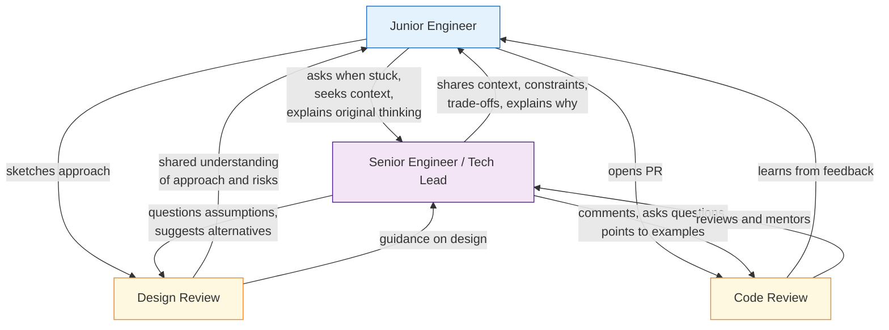

# Engineering Internal Communication

A simple note on how people communicate inside the engineering team — especially between juniors and seniors, and during reviews.

## Everyday discussions

- Juniors ask seniors when they are stuck, unsure about approach, or need context on existing code.
- Seniors share context, constraints, and trade-offs instead of only giving the final answer.
- Short discussions can happen in chat, in person, or in a quick call. Bigger topics can be turned into a design discussion or ticket comment.

## Design reviews

- Before building something non-trivial, the engineer (often with a senior) sketches the approach.
- The group (or a senior) reviews the design: does it fit the system, what are the risks, what are simpler options.
- Juniors learn by seeing how seniors question assumptions, ask for alternatives, and balance speed vs quality.
- Seniors guide by explaining *why* one approach is preferred, not only saying what to change.

## Code reviews

- Code review is both a quality check and a teaching moment.
- Juniors learn by reading comments on their own PRs and by reviewing others’ code.
- Seniors should:
  - Explain the reason behind a suggestion.
  - Point to examples in the codebase when useful.
  - Distinguish between “must fix” and “nice to have / for learning”.
  - Ask questions that help the junior think, instead of only rewriting the code.
- Juniors should:
  - Ask if a comment is unclear.
  - Explain their original thinking when it differs.
  - Look at how similar problems were solved elsewhere in the code.

## Mentoring style

- Seniors set the standard by how they write code, review, and talk about trade-offs.
- Juniors grow faster when they get regular, specific feedback rather than only high-level comments.
- Pairing or screen-sharing on harder problems is often more effective than long written explanations.
- Both sides should keep the tone constructive: the goal is better code and shared understanding, not winning an argument.

## Quick tips

- Prefer asking early over staying stuck for a long time.
- Write down decisions (in PR description, design note, or ticket) so others can follow later.
- Reviews are normal — every engineer, junior or senior, gets comments.

## Mermaid Diagram

Each role appears only once. Arrows show the main communication flows.

---

*Simple companion note to the organization-level information flow document.*
