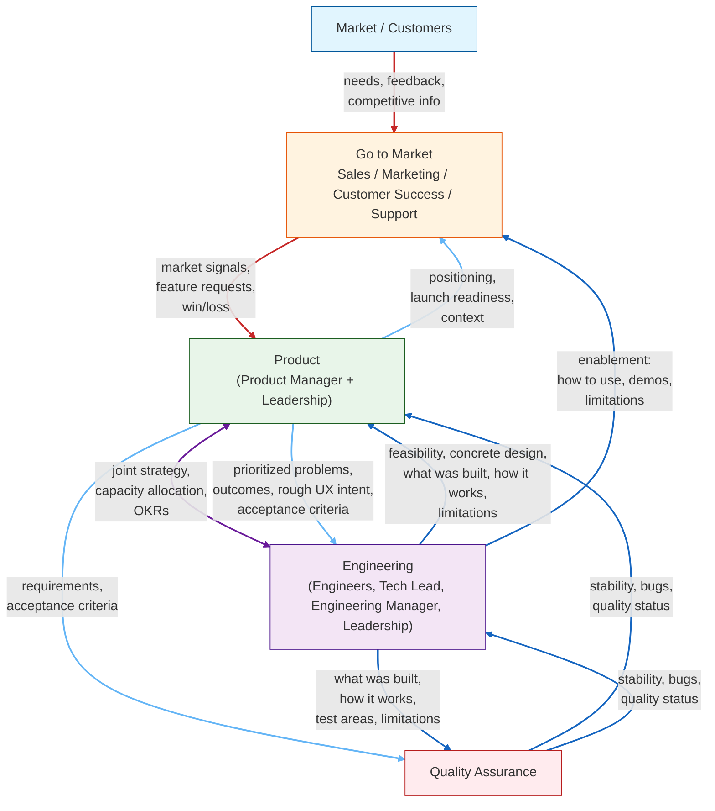

# Organization Roles and Information Flow

Notes on typical roles, teams, and information flows in a product/engineering organization (tech company context). Combines general practices with Scrum elements and higher-level strategy.

Each entity appears only once in the diagram. Tech Lead is a role within Engineering (not a separate entity). Product covers both day-to-day Product Management and Product Leadership.

In many teams (especially smaller or technical ones) there is no dedicated designer. The Product Manager provides a rough sense of the desired UX; Engineering does the concrete design while building, because technical feasibility and constraints are often only clear during implementation.

## Key Roles

- **Market / Customers**: Source of needs, pain points, usage signals.
- **Go to Market (Sales / Marketing / Customer Success / Support)**: Collects market signals, competitive intel, feature requests; receives enablement on what was built.
- **Product**: Owns what and why; prioritizes problems and outcomes; filters inputs; sets product strategy and portfolio allocation; partners on execution. Includes Product Manager and product leadership. Provides rough UX intent and acceptance criteria.
- **Engineering**: Builds the product; owns technical strategy, architecture, capacity, people, and delivery. Includes Engineers, Tech Lead (technical direction within the team), Engineering Manager (people & process), and Engineering Leadership (VP Eng / CTO). Often owns the concrete UI/interaction design because feasibility is discovered while building.
- **Quality Assurance**: Verifies stability, correctness, regression; provides quality status.

## Information Flows (point form)

### Market inputs
- Market / Customers → Go to Market: needs, feedback, competitive info.
- Go to Market → Product: market signals, feature requests, win/loss, customer pain.

### Strategy formation
- Product ↔ Engineering: jointly form product + engineering strategy, capacity allocation (features vs platform vs debt), OKR alignment.

### Execution
- Product → Engineering / Quality Assurance: prioritized problems, outcomes, rough UX intent, acceptance criteria.
- Engineering → Product / Quality Assurance: feasibility, constraints, concrete design decisions, what was built, how it works, limitations.
- Quality Assurance → Product / Engineering: stability, bugs, coverage, quality status.

### Scrum-related loops
- Backlog Refinement: Product + Engineering + Quality Assurance clarify items, acceptance criteria, risks, and rough UX.
- Sprint Planning: Product proposes Sprint Goal; Engineering + Quality Assurance commit and break down work.
- Daily Scrum: Engineering (+ Quality Assurance) sync progress and blockers toward Sprint Goal.
- Sprint Review / Demo: Engineering shows Increment to Product (+ stakeholders including Go to Market); inspect if it matches intent; collect feedback.
- Sprint Retrospective: Product + Engineering + Quality Assurance improve process, handoffs, quality.
- Definition of Done: shared checklist (code review, tests, Quality Assurance verification, docs, Product acceptance).
- Increment: potentially releasable; basis for review and enablement.

### Outside Scrum (strategic / continuous)
- Product discovery & research (customer interviews, competitive analysis) runs in parallel; feeds backlog.
- Roadmap & release planning (quarterly): Product + Engineering capacity.
- Architecture & technical strategy: Engineering leadership; tech debt investment agreed with Product.
- Go-to-market & enablement: after Increment accepted — positioning, demo scripts, sales collateral (Product + Engineering → Go to Market).
- Metrics & outcome reviews: usage data, quality trends, revenue impact → adjust roadmap.
- Cross-team dependencies, security/compliance, incident management, hiring.
- Leadership alignment within Product and Engineering, plus cross-functional portfolio reviews.

### Enablement and feedback
- Engineering (+ Product) → Go to Market: how to use what was built, use cases, limitations, demo scripts.
- Usage + quality data from production → back to Product, Engineering, Quality Assurance for next prioritization.

## Mermaid Diagram

Entities appear only once. Every arrow is labeled with the information that flows.

**Arrow colors:**
- **Red**: information from the market into the company
- **Light blue**: soft information (prioritized problems, outcomes, rough UX intent, acceptance criteria, positioning)
- **Blue**: hard information from the product and code (what was built, how it works, limitations, quality status, enablement)
- **Purple**: bidirectional joint strategy

## Notes

- Tech Lead is a role inside Engineering, not a separate entity.
- Product covers both individual Product Managers and Product Leadership (VP Product / CPO).
- Engineering covers individual Engineers, Tech Leads, Engineering Managers, and Engineering Leadership.
- No separate Design role is assumed. Product Manager supplies rough UX direction; Engineering owns concrete design decisions because technical constraints surface during implementation.
- Flows are bidirectional in practice (partnership model); arrows show primary direction of key information and are all labeled.
- Higher-level strategy sits outside the sprint cadence; Scrum handles delivery inspection and adaptation.
- Arrow colors: red = market into the company; light blue = soft info (problems, intent, acceptance criteria, positioning); blue = hard info (what was built, how it works, quality, enablement); purple = bidirectional strategy.

---

*Generated from discussion on organization structure and information flow.*
