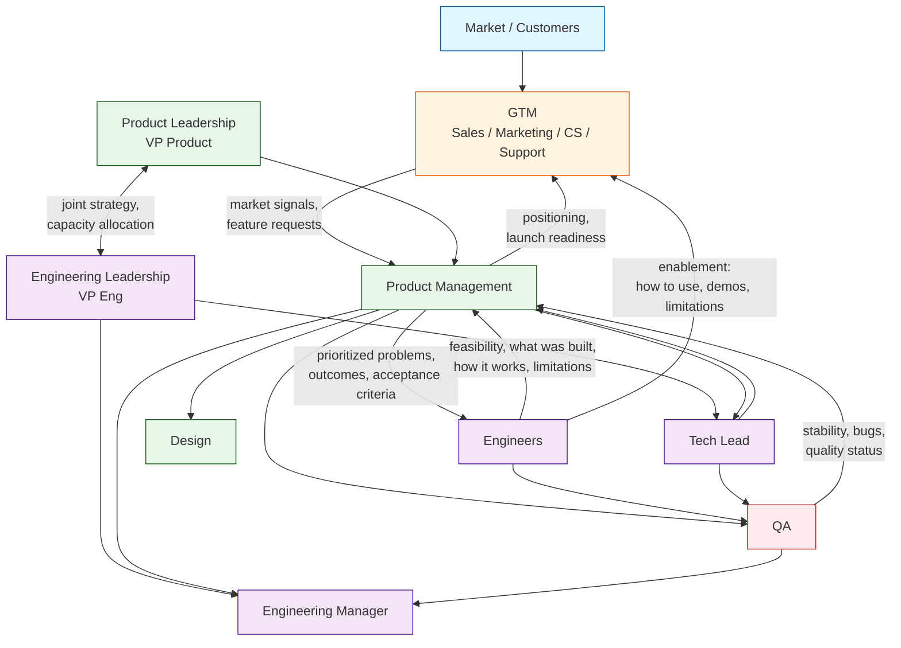

# Organization Roles and Information Flow

Notes on typical roles, teams, and information flows in a product/engineering organization (tech company context). Combines general practices with Scrum elements and higher-level strategy.

Each entity appears only once in the diagram below.

## Key Roles

- **Market / Customers**: Source of needs, pain points, usage signals.
- **GTM (Sales / Marketing / Customer Success / Support)**: Collects market signals, competitive intel, feature requests; receives enablement on what was built.
- **Product Management (PM)**: Owns what and why; prioritizes problems and outcomes; filters inputs; partners on execution.
- **Product Leadership (VP Product / CPO)**: Sets product portfolio strategy and capital allocation; aligns with Engineering leadership.
- **Engineering Leadership (VP Eng / CTO)**: Owns engineering strategy (architecture, capacity, tech debt, process, people).
- **Engineering Manager (EM)**: People management, team process, capacity, delivery health.
- **Tech Lead**: Technical direction and architecture within the team; primary technical partner for PM.
- **Engineers**: Build the product; provide feasibility input; hand off details of what was built.
- **QA**: Verifies stability, correctness, regression; provides quality status.
- **Design**: User experience and interface (often part of product trio).

## Information Flows (point form)

### Market inputs
- Market / Customers → GTM: needs, feedback, competitive info.
- GTM → PM: market signals, feature requests, win/loss, customer pain.

### Strategy formation
- Product Leadership + Engineering Leadership: jointly form product + engineering strategy, capacity allocation (features vs platform vs debt).
- Company strategy / OKRs cascade into this.

### Execution (product trio / squad level)
- PM → Engineers / Tech Lead / EM / QA / Design: prioritized problems, outcomes, acceptance criteria.
- Engineers / Tech Lead → PM / QA: feasibility, constraints, estimates, what was built, how it works, limitations.
- QA → PM / EM: stability, bugs, coverage, quality status.
- Design participates in solution shaping with PM and Tech Lead.

### Scrum-related loops
- Backlog Refinement: PM + Tech Lead + Engineers + QA clarify items, acceptance criteria, risks.
- Sprint Planning: PM proposes Sprint Goal; team (Eng + QA) commits and breaks down work.
- Daily Scrum: Developers (incl. QA) sync progress and blockers toward Sprint Goal.
- Sprint Review / Demo: Team shows Increment to PM (+ stakeholders including GTM); inspect if it matches intent; collect feedback.
- Sprint Retrospective: Team (PM, Eng, QA) improves process, handoffs, quality.
- Definition of Done: shared checklist (code review, tests, QA verification, docs, PM acceptance).
- Increment: potentially releasable; basis for review and enablement.

### Outside Scrum (strategic / continuous)
- Product discovery & research (customer interviews, competitive analysis) runs in parallel; feeds backlog.
- Roadmap & release planning (quarterly): Product Leadership + Eng capacity.
- Architecture & technical strategy: Eng Leadership / principal engineers; tech debt investment agreed with Product.
- Go-to-market & enablement: after Increment accepted — positioning, demo scripts, sales collateral (PM + Eng + Product Marketing → GTM).
- Metrics & outcome reviews: usage data, quality trends, revenue impact → adjust roadmap.
- Cross-team dependencies, security/compliance, incident management, hiring.
- Leadership alignment (VP Product ↔ VP Eng, portfolio reviews).

### Enablement and feedback
- Engineers / Tech Lead (+ PM) → GTM: how to use what was built, use cases, limitations, demo scripts.
- Usage + quality data from production → back to PM, Eng, QA for next prioritization.

## Mermaid Diagram

Entities appear only once. Arrows show primary information / decision flows.

## Notes

- Flows are bidirectional in practice (partnership model); arrows show primary direction of key information.
- Product trio typically: PM + Design + Tech Lead (+ Engineers + QA embedded or close).
- Higher-level strategy sits outside the sprint cadence; Scrum handles delivery inspection and adaptation.
- Same entity represented once; multiple interactions shown as multiple edges from/to that single node.

---

*Generated from discussion on organization structure and information flow.*
